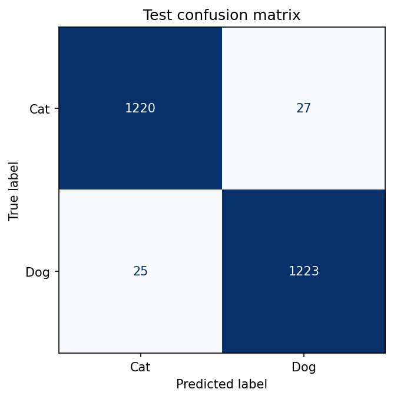
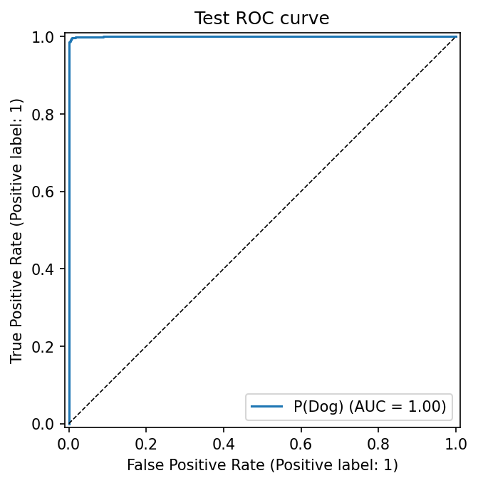
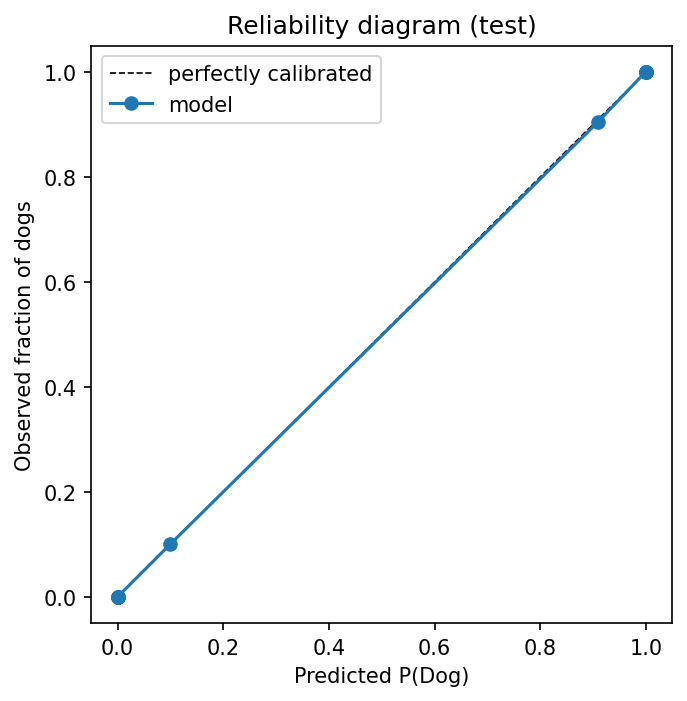
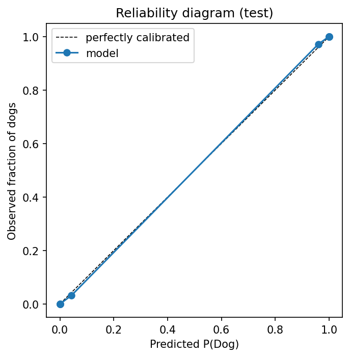
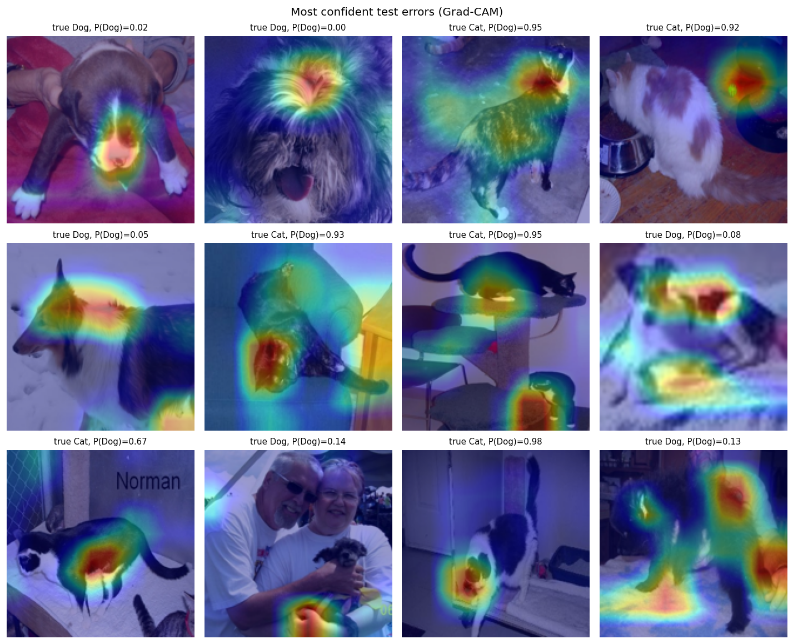
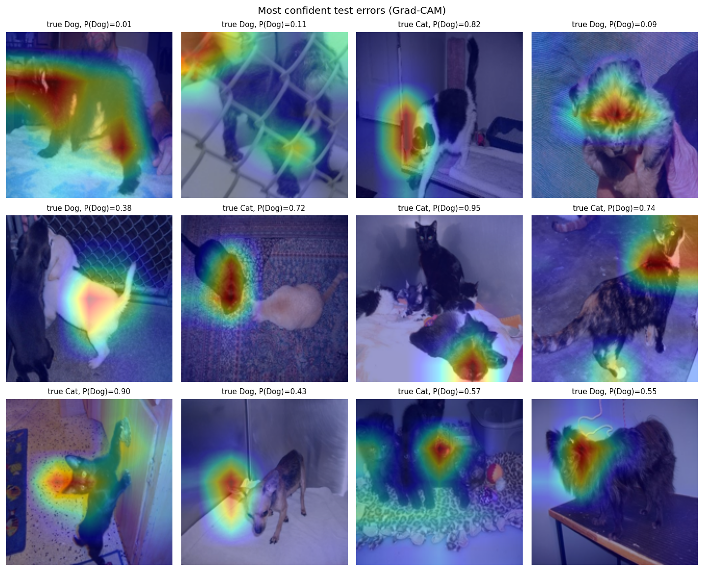

# Cats vs Dogs: from-scratch CNN vs transfer learning, evaluations

Binary image classifier on the Microsoft/Kaggle *Cats and Dogs* dataset (25k photos). The project
compares a CNN I built and tuned from scratch against a fine-tuned EfficientNetB0. It reports results
with confidence intervals, a paired significance test, calibration and slice analysis, and uses
Grad-CAM to show where each model looks when it gets an image wrong.

**[Full run with outputs](notebooks/02_full_run_colab.ipynb)** · **[Reproduce with the CLI on Colab](notebooks/01_reproduce_on_colab.ipynb)** · **[Original v1 notebook](notebooks/00_original_exploration.ipynb)**

## Results

Held-out test set: 2,495 images (1,247 cats, 1,248 dogs), never used for training, early stopping or threshold tuning.
One run on a Colab T4, seed 1.

| model | test accuracy (95% CI) | F1 | ROC AUC | cat recall | dog recall | log loss | ECE |
|:--|:--|--:|--:|--:|--:|--:|--:|
| custom CNN (4.7M params, from scratch) | **97.9%** (97.4–98.5) | 0.979 | 0.9983 | 0.978 | 0.980 | 0.054 | 0.006 |
| EfficientNetB0 fine-tuned (4.0M params) | **99.4%** (99.0–99.7) | 0.994 | 0.9998 | 0.994 | 0.994 | 0.018 | 0.004 |

The custom CNN is the final version from the [ablation below](#improving-the-custom-cnn-ablation):
global-average-pooling head, two 3×3 convs per block, 80 epochs with cosine LR decay, 160×160 input.

**Is the gap real?** Yes, but it is much smaller than before. On the same test images, EfficientNet
was right on 47 images the CNN got wrong, and the CNN was right on 11 that EfficientNet got wrong
(exact McNemar test, p = 2 × 10⁻⁶). The CNN makes 52 errors in total, against EfficientNet's 16.

**No class bias:** both models are balanced. The CNN's recall is 97.8% for cats and 98.0% for dogs,
and its errors split 27 cat→dog and 25 dog→cat. Neither model's accuracy depends much on image
resolution, aspect ratio or brightness. The CNN's slices fall between 95.4% (the 87 images under
150 px) and 99.0%, and EfficientNet's between 98.7% and 100%.

**Calibration:** both reliability curves sit on the diagonal (ECE 0.006 for the CNN, 0.004 for
EfficientNet), so their probabilities can be read at face value. That was not true of the baseline
CNN. It underestimated P(dog) in the uncertain middle range (when it said 10% dog, about 22% were
dogs), even though its overall ECE (0.009) looked fine.

**Data cleaning found** 1 unreadable image per class, 27 bad images from manual review and
26 exact duplicates (17 cats, 9 dogs), which would otherwise risk leaking between train and test.
That leaves 24,947 images.

For reference, the original v1 notebook reported 93.4% test accuracy for the custom CNN. It contained
the evaluation bugs listed below, so that number is not comparable.

### Improving the custom CNN: ablation

Each row adds one change on top of the row above (same data, seed and test set). Changes were judged
on validation; "fixed / broken" counts test images the step got right that the previous step got
wrong, and the reverse (exact McNemar test).

| step | params | epochs (best) | val acc | val loss | test acc (95% CI) | dog recall | fixed / broken vs previous |
|:--|--:|--:|--:|--:|:--|--:|:--|
| original CNN (Flatten → Dense 512) | 8.13M | 40 (38) | 0.939 | 0.230 | 0.949 (0.940–0.957) | 0.921 | |
| + GlobalAveragePooling2D head | 1.57M | 24 (19) | 0.929 | 0.249 | 0.929 (0.919–0.939) | 0.925 | 48 / 98, p = 4e-5 |
| + 80 epochs, cosine LR | 1.57M | 80 (75) | 0.960 | 0.165 | 0.968 (0.962–0.975) | 0.958 | 117 / 18, p = 6e-19 |
| + 2 convs per block | 4.72M | 80 (66) | 0.974 | 0.133 | 0.979 (0.974–0.985) | 0.980 | 49 / 22, p = 0.002 |
| + 224×224 input | 4.72M | 80 (79) | 0.976 | 0.118 | 0.979 (0.973–0.985) | 0.981 | 29 / 30, p = 1 |

- The global-average-pooling head alone made things worse, because the short plateau schedule
  early-stopped it at epoch 24 while it was still underfitting (train accuracy 0.917). Given 80
  epochs with cosine decay, the same model, at a fifth of the parameters, beat the original by 1.9 points
  of test accuracy. The ablation can't separate the head from the longer schedule, because the longer
  schedule was never run with the original head.
- Two convs per block is a real gain (p = 0.002). Going to 224×224 adds a little on validation, but
  nothing measurable on test (29 vs 30 changed images), at about 1.7× the training time per epoch.
- The cat bias is gone: dog recall rose from 0.921 to 0.980.
- Step 3 is the final model. It matches step 4 at about half the training time, so the extra
  resolution was not kept.

### Figures

| | Custom CNN | EfficientNetB0 |
|:--|:--:|:--:|
| Confusion matrix |  |  |
| ROC curve |  |  |
| Reliability diagram |  |  |

The CNN's 52 errors split 27 cat→dog and 25 dog→cat. EfficientNet's 16 errors split evenly, 8 each way.

### Error analysis with Grad-CAM

Each model's 12 most confident test mistakes, with a heatmap of where the model looked. These are
observations from 12 images per model, not a measured rate.

**Custom CNN:** its 12 worst mistakes are now split evenly, 6 dogs called cats and 6 cats called
dogs. Most heatmaps land on the animal, often on the head. The remaining failures are mostly hard
photos: two animals in one frame, a small dog held by two people, or a cat seen from behind.
In a few, the heat sits on an object next to the animal, such as a food bowl.
The baseline CNN was different. 10 of its 12 worst mistakes were dogs called cats, with heat
spread over floors and blankets
([baseline Grad-CAM](reports/figures/cnn_baseline_errors_gradcam.png)).



**EfficientNet:** its heatmaps mostly land on an animal. Several of its remaining mistakes are
photos with more than one animal, or with the animal partly hidden behind a fence, so some may be
ambiguous or mislabeled rather than true model errors. Two photos fool more than one
model. A black cat climbing a door fooled both EfficientNet and the baseline CNN, and a black-and-white
cat stretching up a door fooled both EfficientNet and the final CNN.



## Repository structure

```
cats-vs-dogs/
├── README.md
├── app.py                         Gradio demo (upload a photo, get P(dog) + Grad-CAM)
├── requirements.txt
├── pyproject.toml
├── src/catdog/
│   ├── __init__.py                class order (Cat=0, Dog=1)
│   ├── prepare_data.py            clean, de-duplicate, stratified 80/10/10 split
│   ├── data.py                    tf.data pipeline
│   ├── models.py                  custom CNN and EfficientNetB0
│   ├── train.py                   training CLI
│   ├── evaluate.py                metrics, slices, plots
│   ├── metrics.py                 bootstrap CIs, ECE, threshold tuning, McNemar
│   ├── gradcam.py                 Grad-CAM for both models
│   ├── ablation.py                CNN ablation, one change per run
│   └── compare.py                 results table + McNemar between runs
├── notebooks/
│   ├── 00_original_exploration.ipynb   v1 model-development log
│   ├── 01_reproduce_on_colab.ipynb     every result via the CLI
│   └── 02_full_run_colab.ipynb         the run behind the README, with outputs
├── reports/figures/               plots used in this README
└── tests/test_pipeline.py         end-to-end smoke test on synthetic data
```

## What's in here

| Step | Code | What it does |
|:--|:--|:--|
| Data cleaning | `src/catdog/prepare_data.py` | Drops unreadable files and manually reviewed bad images, removes exact duplicates so no photo appears in both train and test, re-encodes everything to RGB JPEG, and makes a stratified 80/10/10 split with a `manifest.csv`. |
| Pipeline | `src/catdog/data.py` | Caches decoded images as uint8 and shuffles every epoch. Augmentation lives inside the model, so it is re-sampled each epoch and switched off at inference. |
| Models | `src/catdog/models.py` | The from-scratch CNN (5 conv blocks of 1 or 2 3×3 convs with BatchNorm, dropout and L2, then a Flatten → Dense or global-average-pooling head) and EfficientNetB0 with a two-stage schedule: train the head on a frozen backbone, then fine-tune the top 40 layers at 1e-5 with BatchNorm frozen. |
| Training | `src/catdog/train.py` | Checkpoints the best validation-loss model, with early stopping, LR-on-plateau or a cosine LR schedule, and a CSV log. |
| Evaluation | `src/catdog/evaluate.py`, `metrics.py` | Precision/recall per class, ROC AUC, log loss, Brier score, expected calibration error, bootstrap 95% CIs, a threshold tuned on validation (never on test), and accuracy by image resolution, aspect ratio and brightness. |
| Ablation | `src/catdog/ablation.py` | Trains the CNN improvements one change at a time and writes a table with a McNemar test between consecutive steps. |
| Comparison | `src/catdog/compare.py` | Results table plus an exact McNemar test, since both models are scored on the same images. |
| Explainability | `src/catdog/gradcam.py` | Grad-CAM for both architectures, including the nested pretrained backbone. |
| Demo | `app.py` | Gradio app: upload a photo, get P(dog) and a heatmap. Deploys as-is to Hugging Face Spaces. |

## How the custom CNN was developed

The model-development log from v1 is kept in the
[original notebook](notebooks/00_original_exploration.ipynb). In short:

1. **Simple CNN + augmentation:** training accuracy stuck at 75–80%, so the model was underfitting.
2. **Cleaned the data** (corrupted and mislabeled images), added He init, BatchNorm, LR decay and early stopping: training accuracy 85–90%, validation about 75%.
3. **Fixed bias first:** removed augmentation and regularization, stacked two 3×3 convs per block. Training accuracy reached 99%, validation 80–85%, so now it was overfitting.
4. **Then fixed variance one lever at a time:** dropout after every pooling layer, L2 on the dense layer, a fifth conv block, and augmentation added back one transform at a time.

## Bugs found and fixed in v2

| Bug in v1 | Effect | Fix |
|:--|:--|:--|
| `.cache()` placed after the augmentation `map` | Every epoch replayed the first epoch's augmented images, so augmentation was effectively off | Augmentation moved into the model as Keras preprocessing layers |
| Confusion-matrix labels hard-coded as `['Dog', 'Cat']` | Keras orders classes alphabetically (Cat=0), so the axes and the "dog recall" printout were swapped | Class order defined once in `catdog/__init__.py` and used everywhere |
| Evaluated `Cat_Dog_best_model.keras` but saved `Cat_Dog_model.keras` | Reported metrics could not be traced to a training run | `ModelCheckpoint` writes one `model.keras` per run, alongside its config and history |
| Train resized 256→160 in a separate step, while val/test loaded straight at 160 | Train and test images went through different resampling | One loader and one resize path for every split and for the demo |
| (found during v2) Training files were read in class order and shuffled with a 4,096-image buffer | About a third of batches were all cats or all dogs, so the CNN never converged (88% test, validation stuck at 50% early on) | Shuffle buffer covers the whole training split; a regression test checks class mixing (CNN: 88.0% → 94.9%) |

## Run it

```bash
pip install -r requirements.txt
export PYTHONPATH=src

python -m catdog.prepare_data --src PetImages --out data
python -m catdog.train --model cnn    --out runs/cnn    --head gap --convs-per-block 2 --epochs 80 --schedule cosine --patience 15
python -m catdog.train --model effnet --out runs/effnet --epochs 5 --finetune-epochs 10
python -m catdog.evaluate --run runs/cnn
python -m catdog.evaluate --run runs/effnet
python -m catdog.compare runs/cnn runs/effnet --out reports/results.md
python -m catdog.ablation --out runs/ablation --report reports/ablation.md   # CNN: one change per run
python app.py --model runs/effnet/model.keras

pytest -q   # end-to-end smoke test on a tiny synthetic dataset, CPU, about a minute
```

A GPU is strongly recommended for training. The Colab notebook runs everything on a free T4.

## Data

[Microsoft Kaggle Cats and Dogs dataset](https://www.microsoft.com/en-us/download/details.aspx?id=54765),
12,500 images per class before cleaning.
